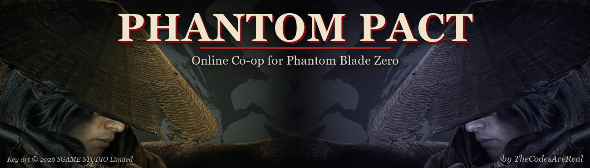

  

# Phantom Pact: online co-op for Phantom Blade Zero

Phantom Pact adds online co-op to **Phantom Blade Zero**. Two players each run their own game and keep their own
save, and Phantom Pact links the two worlds: you see each other, fight the same enemies, take on bosses as a team,
share loot and dust, and rest at bells together. The host's world leads, and your partner joins in.

**Download:** [latest release](https://github.com/yhsharaf/PhantomPact/releases/latest) · **Install and play:**
[INSTALL.md](INSTALL.md) · **Found a bug?** [Open an issue](https://github.com/yhsharaf/PhantomPact/issues/new/choose)

## Features

- See your partner's Soul live, with their moves, attacks, dodges and hit reactions
- Shared enemies in both worlds, with shared health, posture and executions
- Your partner's hits count in the host's world, so you can fight the same enemy together
- Shared boss fights: the boss health bar and arena fog walls for both players
- Shared loot and dust: what either player picks up or earns goes to both
- Shared resting: rest at a bell and enemies respawn for both
- Shared progress (`ShareProgress = On`): quests, bells, enemy-group rewards, challenge points (Banyan Heart,
  Dragon Pillar, Scarecrow), codex entries, opened chests and broken rubbish piles follow both players, applied
  through the game's own functions; new equipment either player gets (from chests or anywhere) goes to both;
  gates, doors, ropes and blocked paths your partner opens open for you too
- Regroup (F5): teleport next to your partner, also into their area, e.g. past a gate only they opened or after
  you respawn at a bell; while your partner is down, F5 revives them to your side
- Your partner's moves on their ghost as the game's own animations: attacks, guard stance, deflects, executions,
  weapon and Phantom Edge skills
- Your partner's dialogue lines appear as tips
- Partner tips: your partner is down / back, their health getting low, watching a cutscene (their ghost hides),
  you've drifted far apart
- Elden Ring–style co-op difficulty: enemies and bosses get more health and posture while you play together
- PvP duels (`PvP = On`): the game's own block, parry and dodge; parries stagger the attacker; the loser dies
- In-game status tips: partner connected or lost, settings that differ between the two PCs

## Quick start

1. Install [UE4SS for Phantom Blade Zero](https://www.nexusmods.com/phantombladezero/mods/5) (both players).
2. Extract the release zip into the game's `PBZ` folder. It includes the native relay (`pbzcoop_relay.exe`), so no
   Python is needed; with the script-only zip, install [Python 3](https://www.python.org/downloads/) instead.
3. In `platform\steam\ue4ss\Mods\PBZCoop\PhantomPact.ini`: host sets `Role = Host`, guest sets `Role = Guest`, and
   both pick a `Network` (below).
4. Start the game and load your saves, the host first. Co-op starts by itself.

## Ways to connect

| `Network =` | What you need | Notes |
|---|---|---|
| `Steam` | Steam friends, both in the game | No IP addresses or port forwarding; `PartnerSteamID = Auto` finds your friend. Encrypted by Steam |
| `Tailscale` (default) | [Tailscale](https://tailscale.com) on both PCs | Guest sets `HostAddress` to the host's Tailscale IP. Only Tailscale addresses are accepted |
| `Direct` | Host forwards UDP 47800 (UPnP does it automatically) | Needs the same `Secret` on both PCs: packets are AES-256-GCM encrypted |

Set a `Secret` (the same on both PCs) with any network for encrypted, authenticated packets. Early release, 2 players.

## Ground rules

- **No DRM bypassing.** Phantom Pact never touches Denuvo or patches the game executable. Everything loads
  through UE4SS and runs inside the normal, legitimately owned game.
- Each player needs their own copy of the game.
- Nothing here contains game files or assets.

## For developers

| Path | What it is |
|---|---|
| [mod/PBZCoop/](mod/PBZCoop/) | UE4SS Lua mod: `coop.lua` (online sync), `pbz.lua` (game adapter: enemies, health, moves, bosses, items), `sync.lua` (shared progress), `status.lua` (in-game tips), `partner.lua` (regroup, revive, partner tips, dialogue), `moves.lua` (partner's moves as montages), `autostart.lua` (reads `PhantomPact.ini`, starts the relay, turns sync on), `main.lua` (loader, commands) |
| [relay/](relay/) | Native relay (Rust, `pbzcoop_relay.exe`): UDP / Steam transport, AES-GCM, UPnP; no Python needed ([docs/NATIVE_PLUGIN.md](docs/NATIVE_PLUGIN.md)). `cargo test --release --manifest-path relay\Cargo.toml` also compile-checks every mod script and runs `sync.lua` / `partner.lua` against stand-ins for the game |
| [net/pbzcoop_net.py](net/pbzcoop_net.py) | Python relay, same protocol (the two interoperate): snapshots + reliable events; host, client, echo, record/replay |
| [net/test_pbzcoop_net.py](net/test_pbzcoop_net.py) | Relay tests: `python -I net\test_pbzcoop_net.py` (also runs native and mixed native/Python pairs once relay/ is built) |
| [net/pbzcoop_bot.py](net/pbzcoop_bot.py) | Bot partner for live tests without a second PC |
| [tools/pbz-coop.ps1](tools/pbz-coop.ps1) | Developer launcher: relay + `neton` by hand (`-Role host/client/echo/loop/record/replay`, `-Stop`) |
| [tools/install-mod.ps1](tools/install-mod.ps1) | Installs the mod into the game's UE4SS `Mods` folder (finds the game through Steam) |
| [tools/pbz-e2e.ps1](tools/pbz-e2e.ps1) | End-to-end test: two copies of the game on one PC, PASS/FAIL per feature; `-Auto` tests the player setup (ini, self-started relays) |
| [tools/pbz-selftest.ps1](tools/pbz-selftest.ps1) | Starts two copies with `-allowmultipleinstances` plus relays; `-Stop` |
| [tools/make-release.ps1](tools/make-release.ps1) | Builds `dist\PhantomPact-<version>.zip` (`-NativeRelay` includes the exe) |
| [docs/COOP_GUIDE.md](docs/COOP_GUIDE.md) | What syncs and how: protocol, enemy matching, tests and results |
| [docs/RECON_NOTES.md](docs/RECON_NOTES.md) | Classes, functions and data tables found in the game |

## Credits

- **Vercadi**, for UE4SS for Phantom Blade Zero, which made modding this game possible
- **The UE4SS team** ([RE-UE4SS](https://github.com/UE4SS-RE/RE-UE4SS))
- **S-GAME and the game's developers** for Phantom Blade Zero

*Fan-made mod, not affiliated with or endorsed by S-GAME.*
